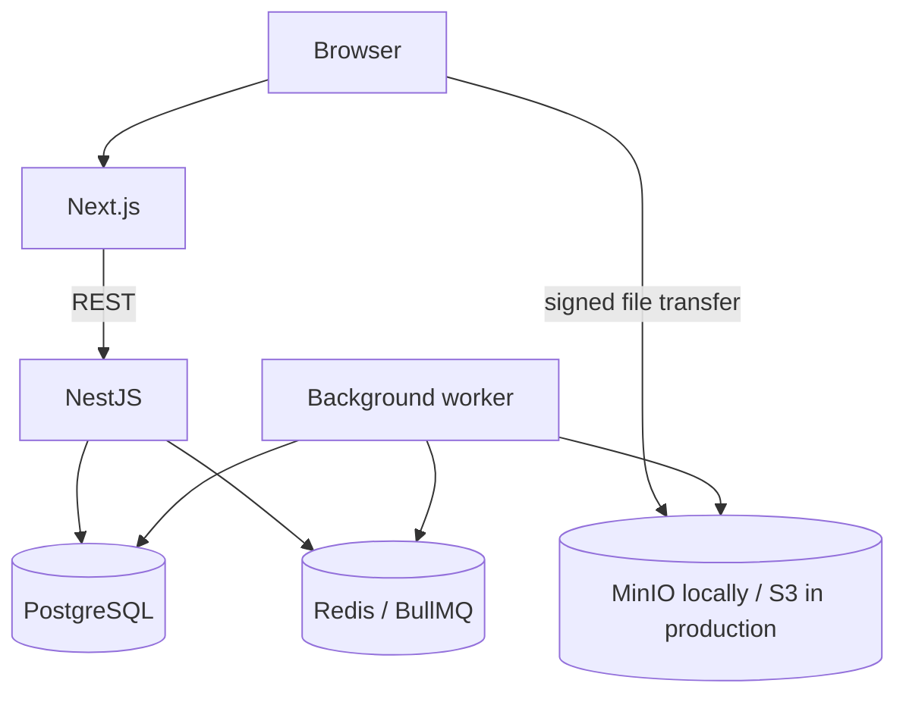

# AssetForge

AssetForge is a multi-tenant workspace for teams to store, review, version, and audit digital assets. This repository is being built in documented phases. The current foundation establishes the separate web, API, and worker applications and local infrastructure; product workflows are not implemented yet.

## Architecture



See [architecture](docs/architecture.md), [database design](docs/database.md), and [project plan](docs/project-plan.md) for system boundaries and phased scope. Architectural decisions are recorded in [docs/adr](docs/adr/).

## Stack

- Web: Next.js 16, React 19, TypeScript, Tailwind CSS
- API: NestJS 12 REST service
- Worker: Node.js process with BullMQ dependency
- Data and local services: PostgreSQL 17, Redis 7, MinIO
- Tooling: pnpm workspaces, strict TypeScript, ESLint, Prettier, GitHub Actions

## Local setup

Requirements: Node.js 22.12 or newer, pnpm 10, and Docker with the Compose plugin.

```powershell
Copy-Item .env.example .env
pnpm install
docker compose up --build
```

Open the web app at `http://localhost:3000`. The API liveness endpoint is `http://localhost:4000/health/live`; readiness is `http://localhost:4000/health/ready`. MinIO console is at `http://localhost:9001` using the local-only values in `.env.example`.

The Compose file publishes ports on loopback and uses named volumes for local data. The example credentials are disposable development values. Replace them before enabling authentication or using any shared environment. `.env` is ignored by Git. Compose currently does not provision the object bucket because upload workflows are not part of this phase.

To run the application processes from the host instead of Compose, start local PostgreSQL, Redis, and MinIO, copy `.env.example` to `.env`, then run `pnpm dev`.

## Checks

```powershell
pnpm lint
pnpm typecheck
pnpm format:check
pnpm build
```

`pnpm check` runs all four checks. Automated feature and security tests will be added with the corresponding implementation phases; the current foundation has no business behavior to test.

## Database and migrations

Prisma schema and migration work is planned for Phase 3. Production database changes will use committed Prisma migrations; `prisma db push` is not a deployment workflow. The current Compose PostgreSQL service is empty.

## API documentation

The API uses `/api/v1` for application routes and keeps `/health/live` and `/health/ready` outside that prefix. OpenAPI/Swagger endpoints will be added with the first API feature phase.

## CI and deployment

GitHub Actions runs install, lint, typecheck, formatting, and build checks. Production deployment documentation will be completed after authentication, storage, queue processing, and database migrations exist. Production should use managed PostgreSQL/Redis, private S3 storage, secret-manager supplied credentials, and separately scalable web/API/worker processes.

## Security and known limitations

Security boundaries and the initial threat model are documented in [docs/security.md](docs/security.md). The current API scaffold uses Helmet, a fixed credentialed CORS origin, and strict request validation defaults, but authentication, rate limiting, authorization, request IDs, API error mapping, file safety, and persistence are not implemented yet. Readiness currently reports process readiness only; database and storage dependency checks will arrive with their clients. The worker connects to Redis but does not consume jobs yet. Performance benchmarks are deferred until representative queries and upload flows exist; no measurements are claimed.

## AI development

See [docs/ai-development.md](docs/ai-development.md) for an honest record of AI-assisted implementation and review.
