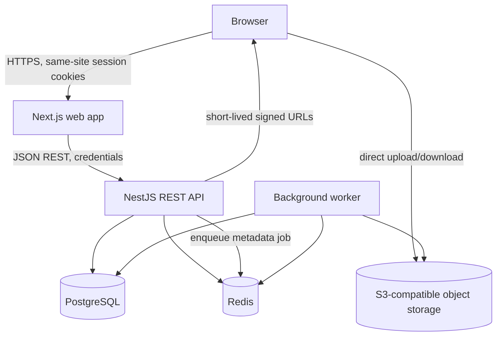

# AssetForge Architecture

## Status and scope

This document describes the intended production architecture and the Phase 2 foundation. The current repository contains application entry points and local infrastructure only; business workflows are planned for later phases.

## System context

## Monorepo boundaries

- `apps/web` owns accessible pages, forms, client-side cache, and calls to the API. It contains no authoritative authorization or business rules.
- `apps/api` owns REST contracts, authentication, authorization, tenant context, validation, transactions, and signed storage URLs.
- `apps/worker` owns asynchronous file inspection, metadata extraction, thumbnail generation, and retryable jobs. It shares domain contracts with the API, not HTTP controllers.
- `packages/config` owns runtime environment parsing shared by server processes.
- Shared domain and UI packages will be introduced when reuse is demonstrated, rather than preemptively.
- `infra` and `docs` hold local runtime definitions and engineering records.

## Backend request flow

The API authenticates a session, resolves the active organization from a validated membership, and passes an immutable request context into application services. Authorization checks are enforced by reusable server-side policy helpers. Services scope every organization-owned query with the resolved organization ID. Resource IDs from the browser never establish tenant access. Prisma transactions couple related writes, while unique constraints and compare-and-set updates enforce invariants under concurrency.

The API validates bodies, query strings, and path parameters at its boundary. A global exception filter will map known domain errors to a stable response envelope and hide implementation details. A request ID is created or validated at ingress and included in structured logs and error responses.

## Authentication and authorization

Use Argon2id password hashes. The browser receives an opaque, HttpOnly, Secure-in-production, SameSite session/refresh cookie; bearer and refresh tokens are not stored in browser local storage. Persist only hashes of refresh credentials, rotate on use, revoke token families on reuse, and store session expiry/revocation server-side. Use same-site cookies plus CSRF tokens/origin checks for state-changing browser requests. Apply rate limits to credential and invitation endpoints.

Membership roles are organization-scoped. The active organization is selected through a membership the server verifies. Route guards establish authentication; policy helpers authorize actions and resource access. Database row-level security may be added as defense in depth, but application scoping and integration tests remain mandatory.

## Tenant and database architecture

PostgreSQL stores normalized identity, organization, collaboration, workflow, metadata, and audit records. Tenant-owned records carry a non-null `organizationId`; compound unique keys and foreign keys include that tenant boundary where useful. Prisma queries are issued through services that require tenant context. The schema and migration design will make cross-organization relations impossible where the relation is tenant-owned.

Initial entity groups:

- Identity: User, Session, RefreshToken, PasswordResetToken, EmailVerificationToken.
- Organization: Organization, OrganizationMember, Invitation, Role/Permission policy definitions.
- Assets: Asset, AssetVersion, AssetFolder, AssetTag, AssetTagRelation, AssetComment, AssetApproval.
- Operations: Notification, AuditLog, BackgroundJob/OutboxEvent, IdempotencyRecord.

High-value indexes include organization plus creation time for asset listing, organization plus status for review queues, organization plus normalized slug, organization plus asset/version number, and user plus unread notification time. Exact indexes will be validated against query plans as endpoints are implemented.

## Upload, storage, and worker flow

The browser asks the API for a short-lived upload authorization after membership, role, file size, declared type, extension, and quota checks. The API creates an upload intent and a unique quarantine key, then returns a signed URL constrained to that object. The browser uploads directly to private S3-compatible storage. It confirms completion; the API verifies object existence/size and idempotently records the asset and an outbox event in one database transaction.

The worker consumes an outbox-backed BullMQ job, verifies file signatures and checksums, extracts safe metadata, creates previews, and updates processing state. Jobs use stable IDs, bounded exponential retries, and a terminal failed state. Original objects remain private; downloads are authorized by the API and use short-lived signed URLs. User-supplied filenames never form storage paths.

## API shape and error handling

The API is versioned under `/api/v1`, documented with OpenAPI, and uses JSON request/response bodies. List endpoints use server-side filtering and cursor or bounded page pagination. Errors follow `{ "error": { "code", "message", "requestId" } }`. Expected validation, authorization, conflict, and missing-resource errors map to 4xx statuses; unexpected failures map to a generic 500 response and structured internal logs.

## Local and production deployment

Local dependencies are PostgreSQL, Redis, and MinIO via Compose. Application processes run through pnpm during development. Production can run the web app, API, and worker as independently scaled containers with managed PostgreSQL/Redis and S3 storage. Secrets come from a deployment secret manager; `.env` is local-only. Migrations run as a controlled release step and use Prisma migrations, never `db push` in production.

## Reliability and observability

Liveness checks indicate whether a process can respond. Readiness checks verify required dependencies without hiding the process from orchestration on transient dependency failure. HTTP requests carry request IDs; logs include service, environment, route, status, duration, and safe user/organization identifiers. Passwords, cookies, authorization headers, signed URLs, and raw file contents are excluded from logs. Queue jobs expose attempt count, latency, and failure reason without sensitive payloads.

## Important tradeoffs

- Direct-to-object-storage uploads reduce API bandwidth and memory pressure, at the cost of an upload intent/completion protocol and reconciliation work.
- Shared PostgreSQL tables with explicit organization keys are simpler to operate than schema-per-tenant, but require disciplined scoping, composite constraints, and isolation tests.
- Opaque server-side sessions simplify revocation and refresh rotation compared with stateless refresh JWTs, at the cost of a database lookup and session storage.
- An outbox closes the gap between committing asset state and publishing work, at the cost of a small dispatcher and outbox retention policy.
