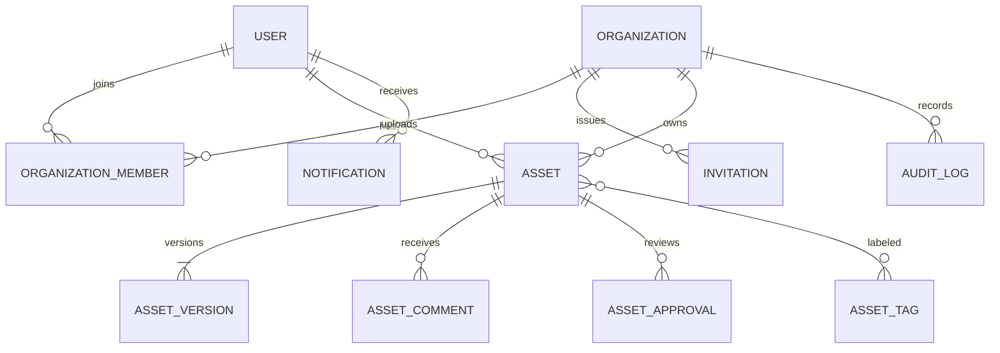

# Database Design (Planned)

PostgreSQL is the relational source of truth and Prisma is the schema/client layer. This Phase 2 repository does not yet contain a Prisma schema or migration; those arrive with the identity and organization phase.

## Relationship sketch

## Planned table groups

| Group         | Tables                                                                  | Important constraints                                                                                                               |
| ------------- | ----------------------------------------------------------------------- | ----------------------------------------------------------------------------------------------------------------------------------- |
| Identity      | User, Session, RefreshToken, PasswordResetToken, EmailVerificationToken | Unique normalized email; token hashes unique; expiry and revocation timestamps                                                      |
| Tenant        | Organization, OrganizationMember, Invitation                            | Unique organization slug; unique `(organizationId, userId)` membership; one active invitation per normalized email and organization |
| Asset         | Asset, AssetVersion, AssetFolder, AssetTag, AssetTagRelation            | Unique `(assetId, versionNumber)`; tenant-aware foreign keys; stable storage key uniqueness                                         |
| Collaboration | AssetComment, AssetApproval, Notification                               | Tenant and resource relation consistency; append-only approval transition records                                                   |
| Operations    | AuditLog, OutboxEvent, IdempotencyRecord                                | Audit actor/action timestamps; unique idempotency scope/key; outbox delivery state                                                  |

## Index strategy

- `Asset(organizationId, createdAt DESC, id)` supports tenant asset feeds and stable pagination.
- `Asset(organizationId, status, createdAt DESC)` supports processing and approval queues.
- `Asset(organizationId, normalizedFilename)` supports exact prefix/search filtering; full-text strategy will be selected after representative search requirements are implemented.
- `AssetVersion(assetId, versionNumber)` is unique and protects concurrent version creation.
- `Notification(userId, readAt, createdAt DESC)` supports unread notification lists.
- `AuditLog(organizationId, createdAt DESC, id)` supports tenant activity feeds.
- Foreign-key columns used in joins receive indexes when PostgreSQL does not create one automatically.

Query plans and representative data measurements will determine whether additional or different indexes are justified. Avoid speculative indexes that increase write cost without measured query benefit.
